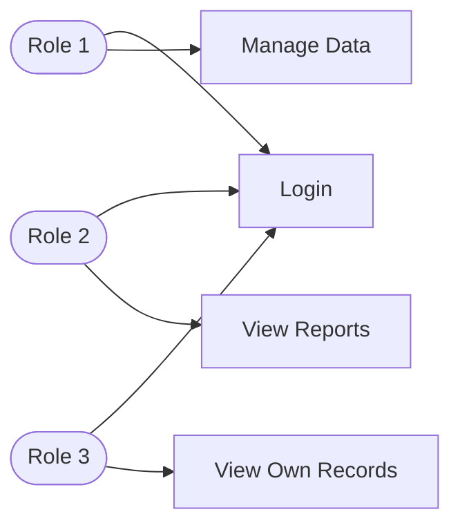

# Project Proposal: PHP + MySQL Application

> **Course:** J620-002-4:2020 Front-End Software Development (Level 4)
> **Competency Unit:** J620-002-4:2020-C01
> **Instructions:** Replace every `[ ... ]` and delete the hint lines (starting with `>`) before submitting. Keep this file as `README.md` in the root of your project repository.

---

## 1. Student Details

| Field | Your Answer |
|---|---|
| Candidate Name | [ ... ] |
| NRIC Number | [ ... ] |
| Date Submitted | [ ... ] |

---

## 2. Project Title

**[ Your project title here ]**

### One-line summary
[ Describe what your application does in one sentence. ]

---

## 3. Problem Statement & Purpose

> What problem does your application solve? Who is it for? Why is it useful?

[ ... ]

---

## 4. Tech Stack

> Required: HTML, CSS, PHP, MySQL.

| Layer | Technology |
|---|---|
| Markup | HTML5 |
| Styling | CSS3 |
| Server-side | PHP |
| Database | MySQL |

---

## 5. Types of Users (Roles)

> Minimum **3 roles**. Each role must have different levels of access.

| Role | Description |
|---|---|
| [ Role 1, e.g. Admin ] | [ ... ] |
| [ Role 2, e.g. Staff ] | [ ... ] |
| [ Role 3, e.g. Customer ] | [ ... ] |

### Role-Based Access Matrix

> Mark what each role can do. Add or remove rows to match your features.

| Feature / Page | Role 1 | Role 2 | Role 3 | Guest (not logged in) |
|---|:---:|:---:|:---:|:---:|
| Register / Login | ✅ | ✅ | ✅ | ✅ |
| [ Feature A ] | ✅ | ❌ | ❌ | ❌ |
| [ Feature B ] | ✅ | ✅ | ❌ | ❌ |
| [ Feature C ] | ✅ | ✅ | ✅ | ❌ |

---

## 6. Features

### 6.1 Core Features (must have)

- [ ] User registration and login
- [ ] Role-based access control (each role sees/does different things)
- [ ] Data management (Create, Read, Update, Delete)
- [ ] [ Your feature ]
- [ ] [ Your feature ]

### 6.2 Extra Features (nice to have)

- [ ] [ Your feature ]
- [ ] [ Your feature ]

### 6.3 Feature Descriptions

> Briefly explain each core feature: what it does and which role uses it.

| Feature | Description | Role(s) |
|---|---|---|
| [ ... ] | [ ... ] | [ ... ] |
| [ ... ] | [ ... ] | [ ... ] |

---

## 7. Data Management System

> Which data can users create, view, edit and delete? Who is allowed to do what?

| Data / Entity | Create | Read | Update | Delete |
|---|---|---|---|---|
| [ e.g. Products ] | [ role ] | [ role ] | [ role ] | [ role ] |
| [ ... ] | | | | |

---

## 8. Database Design

> Minimum **4 tables** with at least **3 linkages** (foreign keys) between them.

### Entity Relationship Diagram (ERD)

> Create your own ERD for your database and place it here. You can draw it in draw.io or dbdiagram.io and insert the exported image (e.g. ``), or write it in Mermaid.

[ Insert your ERD here ]

---

## 9. Use Case Diagram

> Show the actors (roles) and what each can do in the system. Use a Mermaid flowchart below, or export an image from draw.io / Lucidchart to `docs/usecase.png`.

---

## 10. Presentation Checklist

- [ ] Can explain the purpose of the application
- [ ] Can justify design choices (why this database structure, why these roles)
- [ ] Can demo every role
- [ ] Can answer questions about my own code
- [ ] Submitted on time
