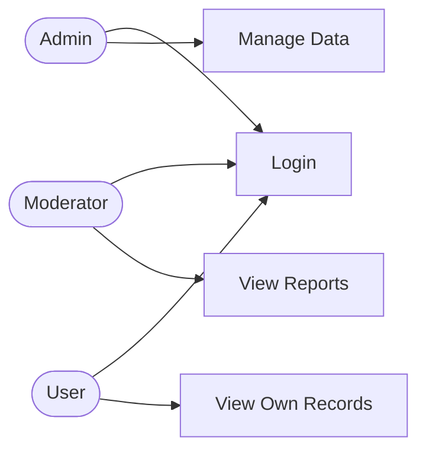

# Project Proposal: PHP + MySQL Application

> **Course:** J620-002-4:2020 Front-End Software Development (Level 4)
> **Competency Unit:** J620-002-4:2020-C01
> **Instructions:** Replace every `[ ... ]` and delete the hint lines (starting with `>`) before submitting. Keep this file as `README.md` in the root of your project repository.

---

## 1. Student Details

| Field | Your Answer |
|---|---|
| Candidate Name | [ ... ] |
| NRIC Number | [ ... ] |
| Date Submitted | [ ... ] |

---

## 2. Project Title

**Health Awareness and Wellbeing application**

### One-line summary
[ Describe what your application does in one sentence. ]
query users based on provided information and using those fields return a conclusion and recommendations for them.
---

## 3. Problem Statement & Purpose

> What problem does your application solve? Who is it for? Why is it useful?

My application solves the lack of health awareness often in people who are overworking themselves, in this case, it would be for adults who are working in a strength straining job, or overall in a stressful environment that could make their health deterioate. its useful through providing insight, tips and solution to the people that use the application and further helps them to love themself better.

---

## 4. Tech Stack

> Required: HTML, CSS, PHP, MySQL.

| Layer | Technology |
|---|---|
| Markup | HTML5 |
| Styling | CSS3 |
| Server-side | PHP |
| Database | MySQL |

---

## 5. Types of Users (Roles)

> Minimum **3 roles**. Each role must have different levels of access.

| Role | Description |
|---|---|
| [ Admin ] | Change user roles to manage background operations. |
| [ Moderator ] | Moderate contents on the forum page to ensure the standards are met. |
| [ Staff ] | Make new threads and pin messages. |
| [ User ] | Interact with query and create posts, comments and chat. |

### Role-Based Access Matrix

> Mark what each role can do. Add or remove rows to match your features.

| Feature / Page | Role 1 | Role 2 | Role 3 | Guest (not logged in) |
|---|:Admin:|:Moderator:|:Staff:|:User:|
| Register / Login | ✅ | ✅ | ✅ | ✅ |
| [  Change user roles  ] | ✅ | ❌ | ❌ | ❌ |
| [ Moderate and oversee the forum contents ] | ✅ | ✅ | ❌ | ❌ |
| [ Create/Post new threads or comment ] | ✅ | ✅ | ✅ | ❌ |

---

## 6. Features

### 6.1 Core Features (must have)

- [ ] User registration and login
- [ ] Role-based access control (each role sees/does different things)
- [ ] Data management (Create, Read, Update, Delete)
- [ ] Query user data for services (Ask the user about their condition)
- [ ] Background forums (For replying to query outside of prepared questions on the website)

### 6.2 Extra Features (nice to have)

- [ ] An ai chatbot for zero wait time (Fetch the FAQ's on the background of the website info for answers)
- [ ] Sorting system based on user query (query the user on what conditions they are facing)

### 6.3 Feature Descriptions

> Briefly explain each core feature: what it does and which role uses it.

| Feature | Description | Role(s) |
| Admin/Moderator | Staff | User |
| [ Forums ] | [ A dedicated forum on the community for the website ] | [ All users ] |
| [ Data management ] | [ Allows for the community to be moderated regularly and up to standards for quality ] | [ Admin, Moderator ] |

---

## 7. Data Management System

> Which data can users create, view, edit and delete? Who is allowed to do what?

| Data | Create | Read | Update | Delete |
|---|---|---|---|---|
| Forums | [ User/Admin/Moderator/Staff ] | [ User/Admin/Moderator/Staff ] | [ Admin/Moderator/Staff ] | [ Admin/Moderator ] |
| User Query | [ User/Admin/Moderator/Staff ] | [ Admin/Moderator/Staff] | [ User/Admin/Moderator/Staff ] | [ User/Admin/Moderator/Staff ] |

---

## 8. Database Design

-- Create the database
CREATE DATABASE IF NOT EXISTS health_wellbeing_db;
USE health_wellbeing_db;

-- ==========================================
-- 1. ROLES TABLE
-- ==========================================
CREATE TABLE roles (
    role_id INT AUTO_INCREMENT PRIMARY KEY,
    role_name VARCHAR(50) NOT NULL UNIQUE
);

-- ==========================================
-- 2. USERS TABLE
-- ==========================================
CREATE TABLE users (
    user_id INT AUTO_INCREMENT PRIMARY KEY,
    role_id INT NOT NULL,
    username VARCHAR(50) NOT NULL UNIQUE,
    email VARCHAR(100) NOT NULL UNIQUE,
    password_hash VARCHAR(255) NOT NULL,
    created_at TIMESTAMP DEFAULT CURRENT_TIMESTAMP,
    -- LINKAGE 1: Connects User to their Role
    FOREIGN KEY (role_id) REFERENCES roles(role_id) ON DELETE RESTRICT
);

-- ==========================================
-- 3. HEALTH ASSESSMENTS (User Query) TABLE
-- ==========================================
CREATE TABLE health_assessments (
    assessment_id INT AUTO_INCREMENT PRIMARY KEY,
    user_id INT NOT NULL,
    occupation VARCHAR(100),
    work_hours_per_week INT,
    stress_level INT CHECK (stress_level BETWEEN 1 AND 10),
    physical_strain VARCHAR(255),
    conclusion TEXT,
    recommendations TEXT,
    created_at TIMESTAMP DEFAULT CURRENT_TIMESTAMP,
    -- LINKAGE 2: Connects Assessment to the User who took it
    FOREIGN KEY (user_id) REFERENCES users(user_id) ON DELETE CASCADE
);

-- ==========================================
-- 4. FORUM THREADS TABLE
-- ==========================================
CREATE TABLE forum_threads (
    thread_id INT AUTO_INCREMENT PRIMARY KEY,
    user_id INT NOT NULL,
    title VARCHAR(255) NOT NULL,
    content TEXT NOT NULL,
    is_pinned BOOLEAN DEFAULT FALSE, -- Staff/Admin can pin messages
    created_at TIMESTAMP DEFAULT CURRENT_TIMESTAMP,
    -- LINKAGE 3: Connects Thread to its Creator
    FOREIGN KEY (user_id) REFERENCES users(user_id) ON DELETE CASCADE
);

-- ==========================================
-- 5. FORUM POSTS (Replies/Comments) TABLE
-- ==========================================
CREATE TABLE forum_posts (
    post_id INT AUTO_INCREMENT PRIMARY KEY,
    thread_id INT NOT NULL,
    user_id INT NOT NULL,
    content TEXT NOT NULL,
    created_at TIMESTAMP DEFAULT CURRENT_TIMESTAMP,
    -- LINKAGE 4: Connects Post to the Thread it belongs to
    FOREIGN KEY (thread_id) REFERENCES forum_threads(thread_id) ON DELETE CASCADE,
    -- LINKAGE 5: Connects Post to its Author
    FOREIGN KEY (user_id) REFERENCES users(user_id) ON DELETE CASCADE
);

-- ==========================================
-- 6. FAQS TABLE (For AI Chatbot Feature)
-- ==========================================
CREATE TABLE faqs (
    faq_id INT AUTO_INCREMENT PRIMARY KEY,
    question VARCHAR(255) NOT NULL,
    answer TEXT NOT NULL,
    keywords VARCHAR(255) -- Helps the chatbot match user queries
);

-- ==========================================
-- SEED DATA (Initial Setup)
-- ==========================================

-- Insert the 4 required roles from your proposal
INSERT INTO roles (role_name) VALUES 
('Admin'), 
('Moderator'), 
('Staff'), 
('User');

-- Insert a default Admin user to help you test immediately
-- Note: The password hash below translates to "password123". 
-- In your PHP code, you should generate new hashes using password_hash($password, PASSWORD_DEFAULT)
INSERT INTO users (role_id, username, email, password_hash) VALUES 
(1, 'admin', 'admin@wellbeing.com', '$2y$10$92IXUNpkjO0rOQ5byMi.Ye4oKoEa3Ro9llC/.og/at2.uheWG/igi');

-- Insert sample FAQs for your Chatbot
INSERT INTO faqs (question, answer, keywords) VALUES
('How do I manage stress at work?', 'Try the 4-7-8 breathing technique, take regular screen breaks, and ensure you are getting 7-8 hours of sleep.', 'stress, work, anxiety, burnout'),
('What are signs of physical strain?', 'Persistent muscle aches, joint pain, chronic fatigue, and decreased mobility are common signs of physical strain.', 'pain, body, strain, physical, hurt');

### Entity Relationship Diagram (ERD)

> Create your own ERD for your database and place it here. You can draw it in draw.io or dbdiagram.io and insert the exported image (e.g. ``), or write it in Mermaid.

[ Insert your ERD here ]

---https://www.vpascode.com/editor/#plantuml:dPJVRzCm4CVV8-L_iFe4bIe6Kb-cgbg0J9rOVv1aYBV8IgwALSVsR8UgslZVEITXCqtB1e_EztpV-rpkV6KirRQfUHYO7HEAQbeJpWJOWm8YjQra68G12CliWOoIzMsSZWWrH4iEXZo40I5ZCclcxfopSlQkcPDBShFAo6os-JAVku39f0jhOmIj0IE-HScdHPIycLwy3OEVliTT6YUTHsD0-nxkVCwZpyxA9-NwoDtTFcNkDAWfuvxm_kAtegWnUwdBlAAcyY8-JATjHA61MYXpQb7CRfPncaNBpH7I8evkiqKUfMcSfijubNLy5VNWq0UCgV7AUSI-0MSGPL4qYbecnGaIPDZbbMoqoHKcsGFikZHED5QZTyxX1_3dhwew65PGdgDCcJW5BqN16zCvPl7tzfg6GjR8KRQb64zvLQ-krydTCiyMIHnzxjgqjLwRR8L9olzjqPYW2OSJA6C7Ox48hrw6lM92WClsSOsZ7wt-4MEpJlj_lLKUX9BcBt_v2N40yJBU4E9rrKPV-pBflRznU7nfgUyRC4SpzznJAimUj5VD3WvkcymWkYsdUrGU7oSJ-T1l_oKPuUQDmg0xzXfk3WeuPug3XO6yTQoZzcaRQiffUyswUnZwX-0QYCFkf2kSONmPVm40

## 9. Use Case Diagram

> Show the actors (roles) and what each can do in the system. Use a Mermaid flowchart below, or export an image from draw.io / Lucidchart to `docs/usecase.png`.

---

## 10. Presentation Checklist

- [ ] Can explain the purpose of the application
- [ ] Can justify design choices (why this database structure, why these roles)
- [ ] Can demo every role
- [ ] Can answer questions about my own code
- [ ] Submitted on time
